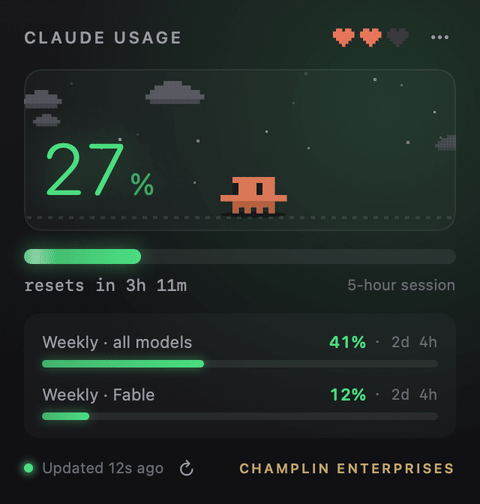
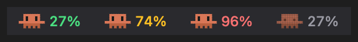
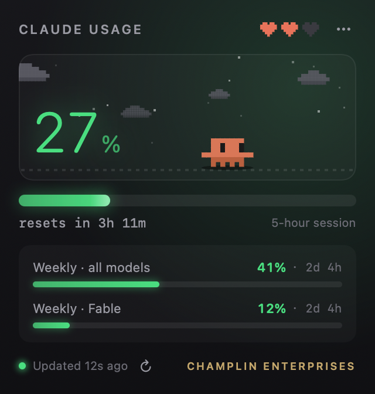
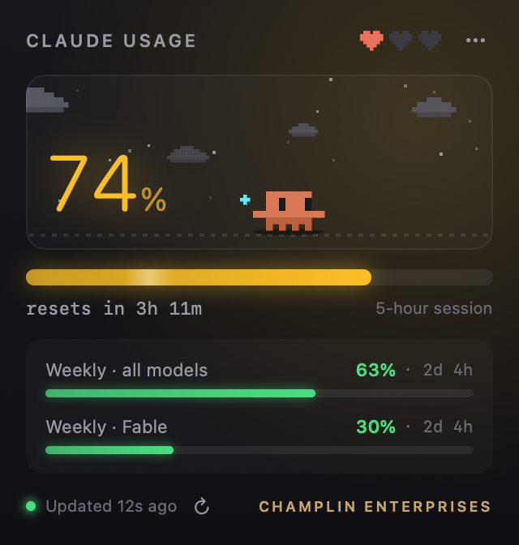
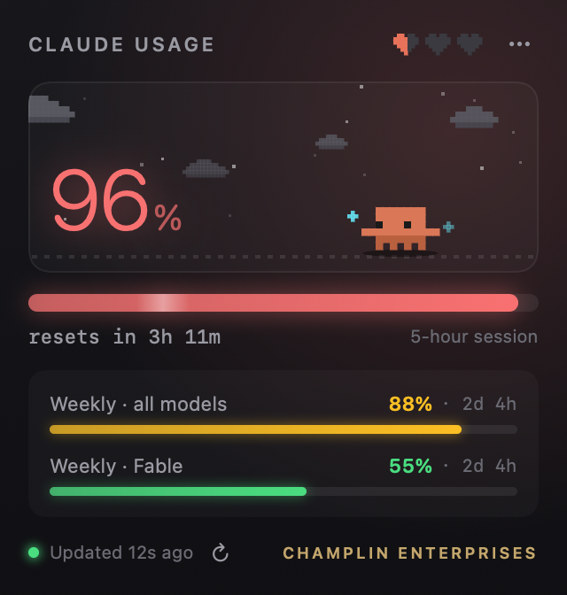
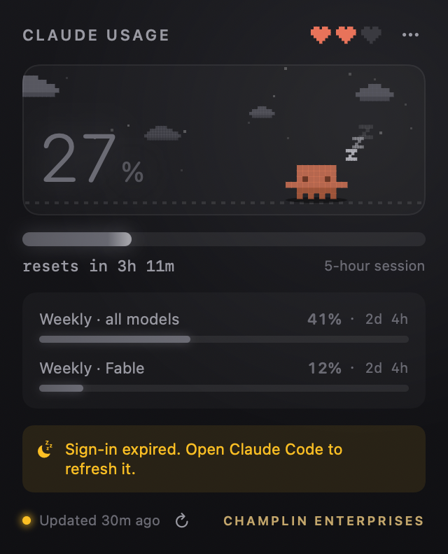

# Claude Usage (menu bar)

A native macOS menu bar app that shows your Claude plan usage. It has an animated
pixel mascot, pixel clouds, hearts for weekly headroom and glowing colored bars.



> **Unofficial.** This is a community project, not affiliated with or endorsed by
> Anthropic. "Claude" is a trademark of Anthropic. It relies on an undocumented
> endpoint that Claude Code itself uses, which may change or break without notice.

## Screenshots

**In the menu bar** (normal, warning, critical, signed out):



**The popover:**

| Normal (under 70%) | Warning (70% and up) |
|---|---|
|  |  |
| **Critical (90% and up)** | **Sign-in expired** |
|  |  |

All screenshots are rendered from sample data with `--snapshot`, not a real account.

## What it shows

- **Menu bar:** the mascot glyph plus the current 5-hour session %, colored green, amber or red.
- **Popover:**
  - the big session % and a "resets in 3h 11m" countdown
  - the weekly limits: all models, plus any model-scoped weekly limit
  - hearts for weekly headroom: 3 full at 0%, empty at 100%
- **The mascot's mood follows the session:**
  - under 70%: happy and walking
  - 70% and up: sweating
  - 90% and up: tired
  - sign-in expired: asleep

Right-click the menu bar item (or use the `...` button) for Refresh, Open usage on
claude.ai, and Quit. Quit stays quit until the next login.

## Install

**Requirements:**

- macOS 14 or later
- the Xcode command line tools (`swiftc`); run `xcode-select --install` if you do not have them
- [Claude Code](https://claude.com/claude-code) installed and signed in on the same Mac, with a Claude Pro or Max plan

```bash
git clone https://github.com/Kevinchamplin/claude-usage-bar.git
cd claude-usage-bar
./install.sh      # builds, copies to /Applications, starts it at login
./uninstall.sh    # removes both
```

**First launch:** macOS will most likely ask whether "Claude Usage" may use the
`Claude Code-credentials` keychain item. Click **Always Allow**. If you click Deny,
the mascot falls asleep as if you were signed out. Because the app is ad-hoc signed,
you may be asked again after rebuilding it.

There is no prebuilt download on purpose: you build it from the source you can read.

## Where the numbers come from (and what it does with your sign-in)

- **No keys in this repo.** It has no API key, token or account of its own.
- **Endpoint:** `GET https://api.anthropic.com/api/oauth/usage`.
- **Sign-in:** it uses the OAuth token that Claude Code keeps in the login keychain
  (item `Claude Code-credentials`).
- **Token handling:** the token is read fresh on every poll and sent only to
  `api.anthropic.com`. The app never logs it, stores it, caches it or refreshes it,
  so it cannot race Claude Code. No analytics, no other network calls.
- **Expired sign-in:** the mascot falls asleep and the popover says so. Run Claude
  Code on that Mac once to refresh the token.
- **Polling:** every 60s, backing off to 10 minutes on HTTP 429. The animation only
  runs while the popover is open.

## Development

```bash
./build.sh                                                        # build/ClaudeUsageBar.app
build/ClaudeUsageBar.app/Contents/MacOS/ClaudeUsageBar --check           # one live fetch, prints %
build/ClaudeUsageBar.app/Contents/MacOS/ClaudeUsageBar --snapshot /tmp/s  # fixture PNGs + frames
```

`--snapshot` renders every state (normal, warning, critical, asleep, loading) and 48
animation frames per mood without touching the network, so design changes can be
reviewed as images. Stitch the frames with
`ffmpeg -framerate 12 -i frames-normal/f%03d.png out.gif`.

**Source files:**

| File | Role |
|---|---|
| `UsageClient` | API calls and the keychain read |
| `UsageStore` | polling |
| `Sprites`, `Scene` | pixel art, drawn in a Canvas |
| `PopoverContent` | popover layout |
| `AppDelegate` | the menu bar item |
| `Fonts.swift` | every font (all fonts go through it) |

## License

[MIT](LICENSE)
